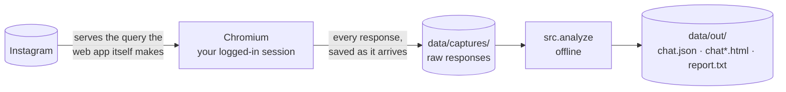
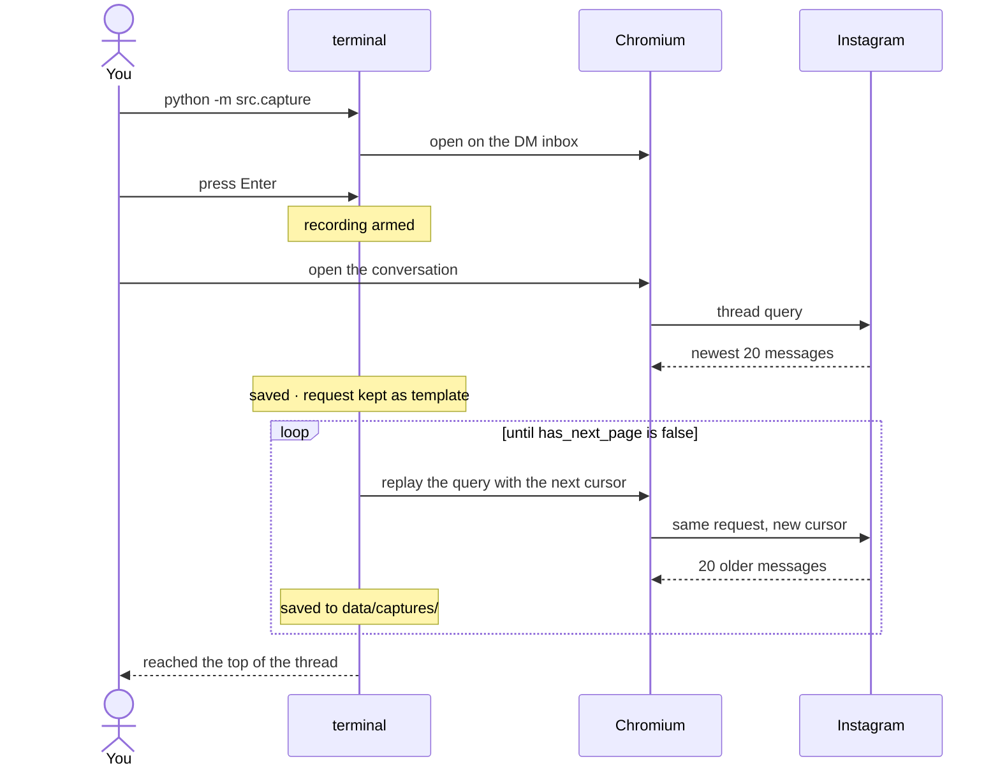

# Overview

[Back to README](../README.md)

## Contents

- [Purpose](#purpose)
- [Why the official export falls short](#why-the-official-export-falls-short)
- [How it works](#how-it-works)
- [Status and responsible use](#status-and-responsible-use)
- [How this was tested](#how-this-was-tested)
- [Privacy](#privacy)
- [Repository layout](#repository-layout)

## Purpose

This project exists so conversations are not lost. A long thread has lasting value,
and Instagram offers no practical way to keep it. Telegram provides a readable
export of a chat; Instagram provides a folder of disconnected rows with the
replies, shares and context removed. That gap is the reason this tool was written,
and the reason it is open source rather than a private script.

## Why the official export falls short

Request "Download your information" from Instagram, open the `messages` folder,
and every message is a flat, standalone row. In both the JSON and the HTML formats:

- **Replies lose their target.** Nothing records which message a reply answers,
  so a conversation full of threaded replies reads as disconnected fragments.
- **Shared posts, reels and stories** arrive as bare links or not at all.
- **Reactions, voice notes, view-once media and system events** are flattened or
  missing.

The same conversation renders correctly on instagram.com, because the web app calls
a GraphQL query that returns far more: each reply carries the **entire message it
replies to, nested inside it**, plus structured attachment cards, reactions with
their senders, and the message type.

Rather than work around the export, this tool drives the real web app, records what
it receives, and rebuilds the thread offline from that data.

## How it works



1. **Capture** opens a real Chromium with a persistent profile, so you log in once.
   Nothing is recorded until you press Enter.
2. You open the conversation. Its first request is recorded and kept in memory as
   a **template**.
3. From then on the tool stops touching the UI. It replays that same request from
   inside the page with the next pagination cursor, repeatedly, until Instagram
   reports there is nothing older. Each response is saved the moment it arrives.
4. **Analyse** reads those files offline, normalises every known message shape,
   and writes the JSON and the HTML.

A run looks like this:



The only outbound traffic is to Instagram itself, plus the optional media download,
which goes to Instagram's own CDN.

For the query shape, message types, pagination and resuming, see
[DEVELOPERS.md](DEVELOPERS.md).

## Status and responsible use

**The project is at an early stage.** The capture flow has been run end to end on
real conversations, but the surface is wide: message types not yet encountered,
threads shaped differently from those tested, and accounts in other states. If
something breaks and you identify the cause, a pull request is welcome. See
[CONTRIBUTING.md](../CONTRIBUTING.md).

**Instagram can change the endpoint or response shape at any time.** The tool reads
an internal, unversioned API by replaying the web app's own request. There is no
contract and no deprecation notice. When a change occurs, capture may stop early or
`analyze report` will list unrecognised message shapes. The tooling reports these
clearly rather than failing silently, but it will still require a fix.

**Use it responsibly.** Archive only conversations you are part of, on an account
you own. A thread belongs to the other participant as much as to you, and they have
not agreed to being archived. Keep captured data private, do not republish it, and
take care with anything pasted into issues or screenshots.

## How this was tested

End to end, against a real account, on two separate conversations: one of about
94,000 messages over three and a half years, and another of about 94,000 over six
months. The procedure was:

1. Run `python -m src.capture`.
2. Log in and land on the inbox.
3. Find the conversation in the inbox list.
4. Press Enter in the terminal to start recording.
5. Click into the conversation and scroll once, so the first thread request fires.
6. Leave it running. The tool pages to the beginning by itself.

Afterwards, `analyze report` confirmed the capture: zero duplicate message ids, an
unbroken cursor chain across every paged request, and no unrecognised message
shapes. The parser and renderer were also exercised against a synthetic thread
containing one of every message kind.

The individual components (request rewriting, the capture loops, pause and resume,
crash handling, and the resume-from-disk cursor) were tested with a stubbed browser,
since those paths are hard to trigger on demand against the real site.

## Privacy

- Auth tokens (`fb_dtsg`, `lsd` and similar) are stripped from every request before
  it is written to disk. The only exception is the in-memory request template used
  for pagination, which is never written or printed.
- Captures, output and the browser profile all live under paths covered by
  `.gitignore`.
- Nothing is uploaded. There is no telemetry and no third-party service.

## Repository layout

```
src/capture/          record a thread from the live web app
  config.py           tunables and fixed values
  state.py            the single run-state dict
  util.py             shared helpers
  terminal.py         stdin, Ctrl+C pausing, end-of-run reports
  recording.py        saving responses, stripping auth, tracking progress
  browser.py          launching Chromium, wiring pages, blocking media
  paging.py           replaying the thread query by cursor (default)
  scrolling.py        driving the UI (fallback)
  resume.py           finding and offering the saved cursor
  __main__.py         entry point

src/analyze/          turn captures into an archive
  load.py             find message nodes in any capture shape
  parse.py            raw node -> render-ready message
  schema.py           the report, including what was not understood
  render.py           markup for one page
  pages.py            splitting, navigation and the index
  assets.py           the stylesheet and script
  media.py            optional CDN mirroring
  __main__.py         entry point

data/                 gitignored
  captures/           raw responses
  out/                chat.json, chat*.html, media/, report.txt
```
